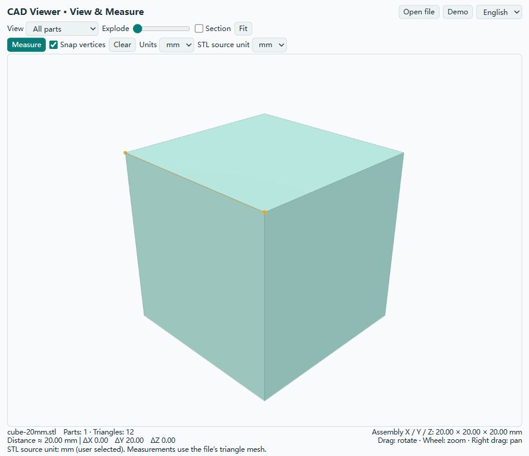

# CAD Viewer for ChatGPT desktop

English · [简体中文](README.md)

View local STEP/STL models, inspect assemblies and measure approximate dimensions. Community beta 0.2.0, with English and Simplified Chinese interfaces.



## Features

- Local STEP/STP conversion with part names and colors; STL loading with explicit source units.
- Orbit, zoom, pan, part isolation, exploded views and open section clipping.
- Point-to-point distance, XYZ differences, nearest triangle vertex snapping and axis-aligned bounding dimensions.
- Display units: mm, cm and in. STL source units: mm, cm, m and in.
- Instant English / Chinese switching. View, clipping, selection and measurements survive language changes; original file and part names are retained.
- MCP Apps UI and ChatGPT file entry points, with a browser preview for compatibility.

## Install

Requires Node.js 22+ on PATH and a desktop ChatGPT / Codex host that supports local plugins. Use a local conversation. The repository and release ZIP include built runtime files; installing development dependencies is unnecessary for use.

```text
codex plugin marketplace add HappyGame137/cad-viewer-chatgpt
codex plugin add cad-viewer@cad-viewer-community
```

Alternatively, download and extract a release, then register its absolute directory:

```text
codex plugin marketplace add /absolute/path/to/cad-viewer-chatgpt
codex plugin add cad-viewer@cad-viewer-community
```

Restart the desktop app and use a new local conversation. Try “Open this STEP file and show its overall dimensions.” Host support for native file entry points varies by app version.

For a standalone local preview:

```text
node dist/server.mjs --preview --model /absolute/path/to/model.step
```

Open the printed loopback URL. Omit `--model` to view a generic assembly, or add `--port` to choose an available port.

Choose 中文 / English at the top right. Chinese browser languages initially select Chinese; other browser languages select English. A manual choice is remembered when local storage is available.

## Measure

Turn on Measure and click two points. The viewer reports distance and absolute XYZ differences. Snap vertices selects the nearest vertex of the clicked triangle; turn it off to pick a point on the triangle. A third click starts a new measurement. Exploded-view measurements use original assembly coordinates.

Turning Measure off clears its points and line. Clipped or hidden endpoints are hidden. The canvas fills the remaining window height below the compact controls; model details and hints appear in the footer.

STEP is imported in millimetres with a default display mesh tolerance of 0.05 mm. This parameter is not a guaranteed measurement error. Measurements use the display triangle mesh; exact B-rep measurement, automatic hole diameter, radius, angle, minimum gap and wall thickness are not implemented. Bounding dimensions use the original axes, rather than an arbitrary minimum-volume orientation. Section clipping does not fill cut faces.

STL has no built-in unit: choose its source unit correctly before relying on dimensions. STL files generally cannot recover the original assembly tree. Limits: 30 MB per file, one million triangles, and 45 seconds for STEP conversion.

## Privacy

See [PRIVACY.md](PRIVACY.md). The plugin performs conversion locally and calls no conversion cloud, telemetry or advertising services. When run in an MCP host, the host receives tool data and display geometry. Local conversion does not mean the host never processes derived model data. The only UI preference persisted by this plugin is the selected language.

Default file access is limited to the user's home and launch working directory. Configure `CAD_VIEWER_ALLOWED_ROOTS` for other directories (semicolon-separated on Windows, colon-separated on macOS/Linux). Input CAD files are never overwritten. Public examples and screenshots contain generic geometry only.

## Develop and share

```text
pnpm install --frozen-lockfile --ignore-scripts
pnpm run build
pnpm test
pnpm run package
```

Original code is MIT licensed; third-party components retain their own licenses. See LICENSE and THIRD_PARTY_NOTICES.txt. This free community beta can be shared through its repository, ZIP and custom marketplace; it is not an approved OpenAI directory listing. No payments or advertisements are included.
