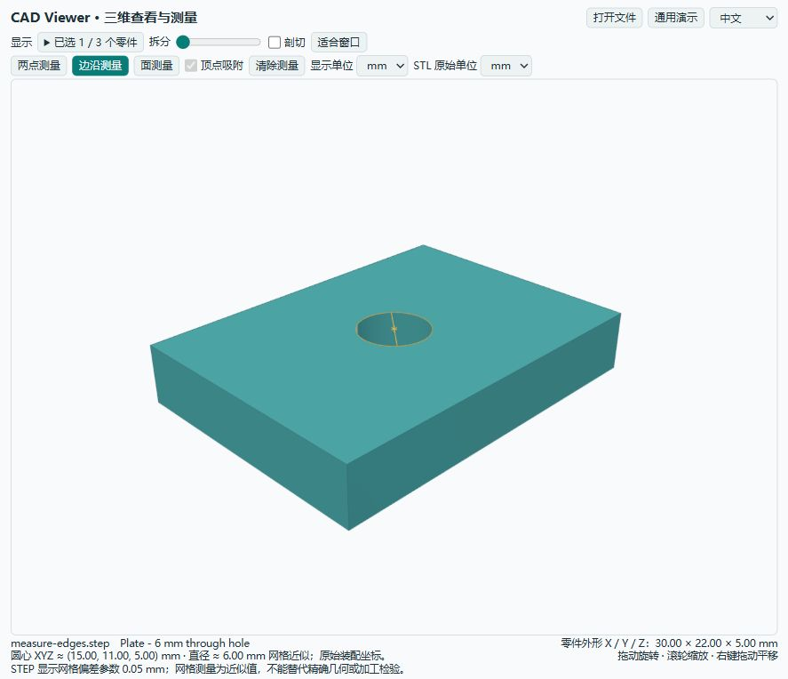
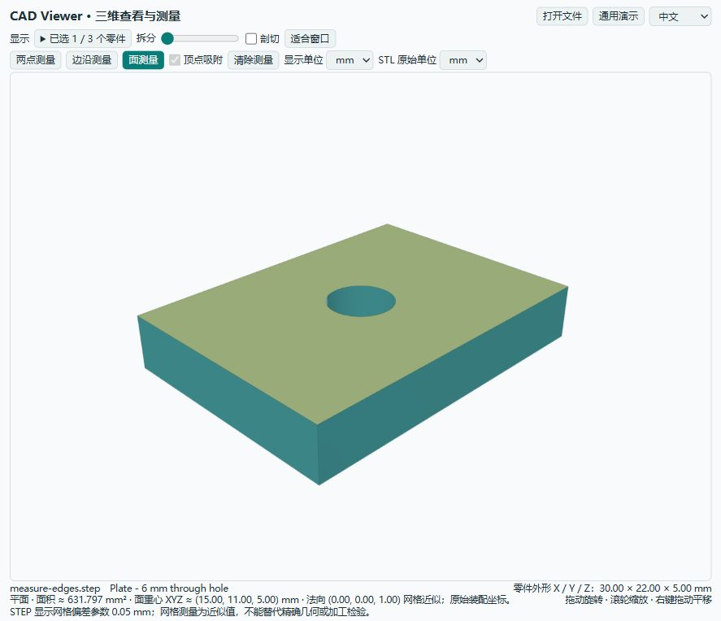
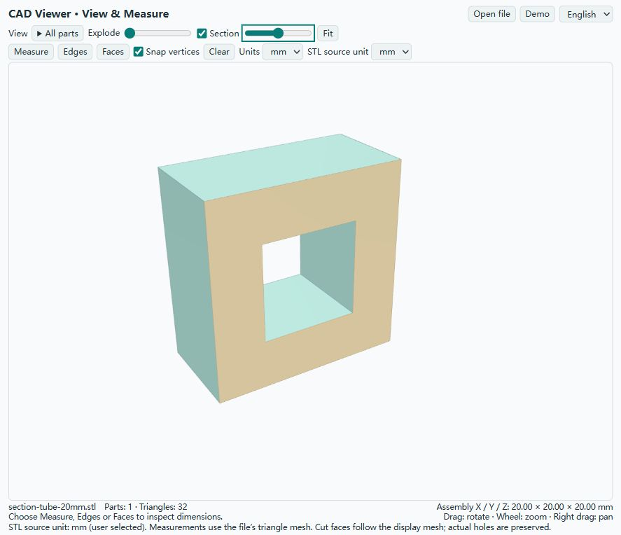

# CAD Viewer for ChatGPT desktop

在 ChatGPT 桌面应用中查看 STEP / STL、拆分装配并测量尺寸。早期测试版 0.4.0。

[English documentation](README.en.md) · 简体中文

Local STEP/STL viewing and approximate mesh measurement for ChatGPT desktop. Requires Node.js 22+ on PATH. Install the repository as a local plugin marketplace, restart the app, and use a new local conversation. See the commands below. This community beta is not an OpenAI-approved directory listing.


## 功能

- STEP / STP 装配与 STL：本地转换、保留 STEP 零件名与颜色。
- 旋转、缩放、平移、零件复选显示、装配拆分、实体截面补面与真实孔洞保留。
- 两点测量、最近网格顶点吸附、XYZ 差值与轴向整体外形尺寸。
- 边沿测量：圆心与直径、直边长度与端点、圆弧半径与弧长、一般曲线近似长度。
- 面测量：面积、面积重心、平面法向；可识别圆柱面的直径、轴线与轴向高度。
- mm / cm / in 显示，STL 原始单位可指定为 mm / cm / m / in。
- 中文 / English 即时切换，首次按浏览器语言选择，记住手动选择。切换时保留视角、剖切和测量，文件名与零件原名保持不变。
- 标准 MCP Apps 界面与 ChatGPT 文件查看入口；提供普通浏览器预览作为兼容方案。

## 安装

需要 Node.js 22 或更高版本，以及支持本地插件的 ChatGPT 桌面应用 / Codex。插件用于本地运行的对话。

下载发布包并解压，或克隆此仓库。发布包及仓库中的 `dist/` 已包含运行所需代码，无须先安装开发依赖。

直接从 GitHub 添加来源：

```text
codex plugin marketplace add HappyGame137/cad-viewer-chatgpt
codex plugin add cad-viewer@cad-viewer-community
```

从 GitHub 来源安装后，更新时执行以下命令，再重新打开桌面应用：

```text
codex plugin marketplace upgrade cad-viewer-community
codex plugin add cad-viewer@cad-viewer-community
```

下载解压后也可使用本地目录：

```text
codex plugin marketplace add /absolute/path/to/cad-viewer-chatgpt
codex plugin add cad-viewer@cad-viewer-community
```

也可在桌面应用的插件目录中选择 CAD Viewer Community 来源，再安装 CAD Viewer。重新启动桌面应用后，在新的本地对话中使用插件，例如：

> 打开这个 STEP 文件，并显示整体尺寸。

> 开启两点测量，我要检查两个安装面之间的距离。

当前对话未重新加载插件时，可以先预览：

```text
node dist/server.mjs --preview --model /absolute/path/to/model.step
```

打开输出的 `http://127.0.0.1:3941`。省略 `--model` 可查看通用演示。用 `--port` 指定其他空闲端口。

界面右上角可选择“中文”或“English”。中文浏览器默认显示中文，其他语言默认显示英文。宿主允许本地存储时，手动选择会在后续打开时保留。

## 尺寸测量

开启“两点测量”，依次点击两个点，读出距离和 XYZ 差值。默认吸附当前命中三角面的最近顶点；关闭吸附可拾取三角面上的点。再次点选将开始新的测量。拆分显示中的测量使用零件的原始装配坐标。

关闭“两点测量”会清除测量点和测量线；重新开启从第一个点开始。被剖切或隐藏的零件上的标记随之隐藏。文件名、尺寸和操作提示合并在图下，顶部控件采用紧凑布局，三维画图区自动占用剩余窗口高度。

STEP 按毫米导入，默认显示网格偏差参数 0.05 mm。该参数不是测量误差保证。两点、边沿与面的参数均取自显示网格，尚未实现精确 B-rep 计量、两边夹角、最小间隙或壁厚检验。整体尺寸是原始坐标系的轴对齐外包框，不能当作任意方向的最小包络尺寸。

## 边沿、面与零件复选

开启“边沿测量”，点击可见的边沿即可高亮并显示参数。圆边可点圆周或圆形内部，显示圆心 XYZ 和直径；直边显示长度与两个端点；圆弧显示半径、弧长、角度、圆心和端点；无法可靠拟合为圆的边沿保留为普通曲线，显示近似长度。圆心采用十字标记，关闭模式或清除测量会移除标记。

开启“面测量”，点击平面可查看网格面积、面积重心和法向。可识别的圆柱面还显示直径、轴向和轴向高度；其他曲面显示网格面积、重心和外包尺寸，不提供一个虚构的固定法向。STEP 利用原有面的三角面范围；STL 合并相邻共面的网格片，不能恢复原始曲面拓扑。剖切补面也可独立测量，移动剖切位置时会清除过期的截面选择。

面积重心未必位于面上，例如带孔平面的重心可能在孔内。圆柱高度表示所识别面沿轴线的范围。原始面参数按原始完整面计算；显示剖切不会把它变成可见部分的面积。所有坐标和长度按原始装配计算，拆分显示不改变测量值。面积随显示单位按平方换算。

“显示”展开后可复选任意零件，提供全选和全不选。所选零件的原始外包尺寸会同步更新，隐藏零件上的测量高亮也会隐藏。点“适合窗口”可让当前所选零件铺满视图。





通用示例 `examples/measure-edges.step` 包含 Ø6 mm 通孔板、Ø10 mm 圆柱和 R10/R6 四分之一圆弧。边沿分析每个零件最多处理 25 万三角面、5000 个边沿和 10 万个边沿采样点；超过时提示识别受限。面分组超过 1 万个或网格过密时，面测量退化为结果中明确标注的单个网格三角面。

STL 没有内置单位。加载时选择正确的 STL 原始单位，避免 25.4 倍等比例错误。STL 装配通常不能自动还原为原始零件树。

开启“剖切”后，切开的实体区域显示为暖色截面，真实孔洞和空腔保持为空。截面可参与两点测量，结果仍属于显示网格近似。补面仅用于显示，不会写入原模型。若截线未闭合或存在分叉，该零件不补面并显示提示，避免把未知空腔填成实体。`examples/section-tube-20mm.stl` 提供外形 20 mm、通孔 10 mm 的通用检查模型。



支持单个文件最大 30 MB、最多 100 万三角面、STEP 转换最长 45 秒。较大或复杂装配可能需要降低显示精度或拆分文件。

## 文件与隐私

详见 [PRIVACY.md](PRIVACY.md)。插件自身不连接云端转换、分析或广告服务；在 ChatGPT 中调用时，宿主会接收工具摘要与用于显示的网格数据。不要把“本地转换”理解为宿主完全不处理模型数据。

默认只读取用户目录与启动工作目录内明确指定的 CAD 文件。外部磁盘可通过 `CAD_VIEWER_ALLOWED_ROOTS` 指定允许目录；Windows 用分号，macOS/Linux 用冒号分隔。插件不保存或覆盖输入模型。

## 开发

```text
pnpm install --frozen-lockfile --ignore-scripts
pnpm run build
pnpm test
pnpm run package
```

`server/` 实现本地 MCP、转换与几何参数分析；`web/` 实现查看与交互测量。`examples/` 仅有通用模型与已知尺寸的测量示例。用户工程和模型不属于发布包。

## 发布状态

这是可通过源码 / ZIP / 自定义 marketplace 分享的测试版，尚未获得 OpenAI 官方插件目录审核或认证。官方目录中的本地 MCP 插件提交目前需要批准的合作伙伴资格和开发者身份验证，见 [官方桌面插件发布指南](https://developers.openai.com/plugins/deploy/desktop-only)。宿主中的文件入口是否可用取决于桌面应用版本；普通浏览器预览、MCP 协议测试与真实宿主安装测试应分别确认。

首版免费分享。暂未加入支付、广告或付费升级。原始插件代码使用 MIT；第三方组件保留自己的许可，详见许可证和第三方声明。
