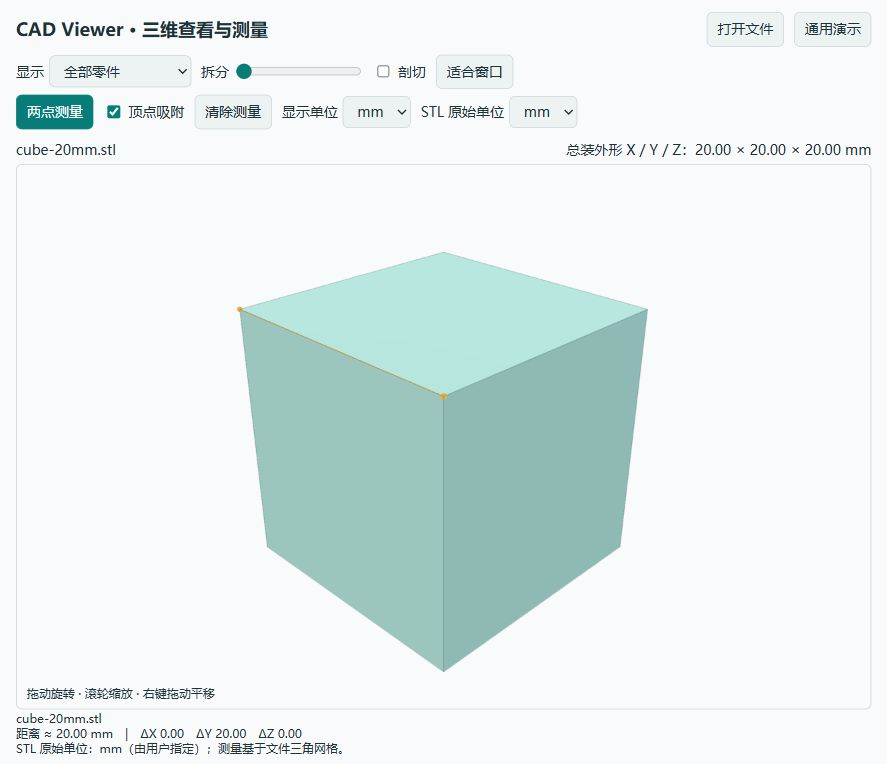

# CAD Viewer for ChatGPT desktop

在 ChatGPT 桌面应用中查看 STEP / STL、拆分装配并测量尺寸。早期测试版 0.1.0。

Local STEP/STL viewing and approximate mesh measurement for ChatGPT desktop. Requires Node.js 22+ on PATH. Install the repository as a local plugin marketplace, restart the app, and use a new local conversation. See the commands below. This community beta is not an OpenAI-approved directory listing.



## 功能

- STEP / STP 装配与 STL：本地转换、保留 STEP 零件名与颜色。
- 旋转、缩放、平移、单零件查看、装配拆分、开放式剖切。
- 两点测量、最近网格顶点吸附、XYZ 差值与轴向整体外形尺寸。
- mm / cm / in 显示，STL 原始单位可指定为 mm / cm / m / in。
- 标准 MCP Apps 界面与 ChatGPT 文件查看入口；提供普通浏览器预览作为兼容方案。

## 安装

需要 Node.js 22 或更高版本，以及支持本地插件的 ChatGPT 桌面应用 / Codex。插件用于本地运行的对话。

下载发布包并解压，或克隆此仓库。发布包及仓库中的 `dist/` 已包含运行所需代码，无须先安装开发依赖。

直接从 GitHub 添加来源：

```text
codex plugin marketplace add HappyGame137/cad-viewer-chatgpt
codex plugin add cad-viewer@cad-viewer-community
```

下载解压后也可使用本地目录：

```text
codex plugin marketplace add /absolute/path/to/cad-viewer-chatgpt
codex plugin add cad-viewer@cad-viewer-community
```

也可在桌面应用的插件目录中选择 CAD Viewer Community 来源，再安装 CAD Viewer。重新启动桌面应用后，在新的本地对话中使用插件，例如：

> 打开这个 STEP 文件，并显示整体尺寸。

> 开启两点测量，我要检查两个安装面之间的距离。

当前对话未重新加载插件时，可以先预览：

```text
node dist/server.mjs --preview --model /absolute/path/to/model.step
```

打开输出的 `http://127.0.0.1:3941`。省略 `--model` 可查看通用演示。用 `--port` 指定其他空闲端口。

## 尺寸测量

开启“两点测量”，依次点击两个点，读出距离和 XYZ 差值。默认吸附当前命中三角面的最近顶点；关闭吸附可拾取三角面上的点。再次点选将开始新的测量。拆分显示中的测量使用零件的原始装配坐标。

STEP 按毫米导入，默认显示网格偏差参数 0.05 mm。该参数不是测量误差保证。点到点距离取自三角网格，未实现精确 B-rep 测量、自动孔径、半径、角度、最小间隙或壁厚检验。整体尺寸是原始坐标系的轴对齐外包框，不能当作任意方向的最小包络尺寸。

STL 没有内置单位。加载时选择正确的 STL 原始单位，避免 25.4 倍等比例错误。STL 装配通常不能自动还原为原始零件树。

支持单个文件最大 30 MB、最多 100 万三角面、STEP 转换最长 45 秒。较大或复杂装配可能需要降低显示精度或拆分文件。

## 文件与隐私

详见 [PRIVACY.md](PRIVACY.md)。插件自身不连接云端转换、分析或广告服务；在 ChatGPT 中调用时，宿主会接收工具摘要与用于显示的网格数据。不要把“本地转换”理解为宿主完全不处理模型数据。

默认只读取用户目录与启动工作目录内明确指定的 CAD 文件。外部磁盘可通过 `CAD_VIEWER_ALLOWED_ROOTS` 指定允许目录；Windows 用分号，macOS/Linux 用冒号分隔。插件不保存或覆盖输入模型。

## 开发

```text
pnpm install --frozen-lockfile --ignore-scripts
pnpm run build
pnpm test
pnpm run package
```

`server/` 实现本地 MCP 和转换；`web/` 实现查看与测量。`examples/` 仅有通用装配和已知 20 mm 立方体。用户工程和模型不属于发布包。

## 发布状态

这是可通过源码 / ZIP / 自定义 marketplace 分享的测试版，尚未获得 OpenAI 官方插件目录审核或认证。官方目录中的本地 MCP 插件提交目前需要批准的合作伙伴资格和开发者身份验证，见 [官方桌面插件发布指南](https://developers.openai.com/plugins/deploy/desktop-only)。宿主中的文件入口是否可用取决于桌面应用版本；普通浏览器预览、MCP 协议测试与真实宿主安装测试应分别确认。

首版免费分享。暂未加入支付、广告或付费升级。原始插件代码使用 MIT；第三方组件保留自己的许可，详见许可证和第三方声明。
